# Нервион

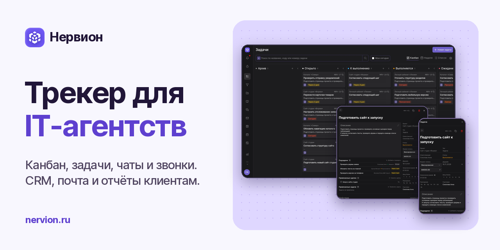

Нервион помогает IT-студиям и digital-агентствам вести клиентские проекты от сделки до отчёта. Команда работает с задачами на канбане, обсуждает их в чатах и голосовых комнатах. Аккаунт-менеджер ведёт сделки в CRM, переписывается с клиентом по почте и выгружает в Excel подробный отчёт о выполненных работах. Трекер с открытым кодом можно установить на своём сервере.

[Живое демо](https://preprod.app.nervion.ru/try?utm_source=github&utm_medium=readme) · [Установка](./docs/self-hosted.md) · [Документация](./docs/README.md) · [Сайт](https://nervion.ru)

[Клиентские проекты](#клиентские-проекты) · [Общение и документы](#общение-и-документы) · [Учёт времени и отчёты](#учёт-времени-и-отчёты) · [Инструменты и доступ](#инструменты-и-доступ)

## Клиентские проекты

### Доска задач

Переключайтесь между канбаном, списком задач и недельным видом. Настраивайте этапы, фильтруйте задачи по проекту и ответственному, оценивайте объём работы в Story Points.

### Карточка задачи

Разбивайте работу на подзадачи, назначайте ответственных и сроки, связывайте задачи между собой. Обсуждение и история изменений остаются в карточке. Черновик задачи можно надиктовать и оформить с помощью ИИ.

### CRM

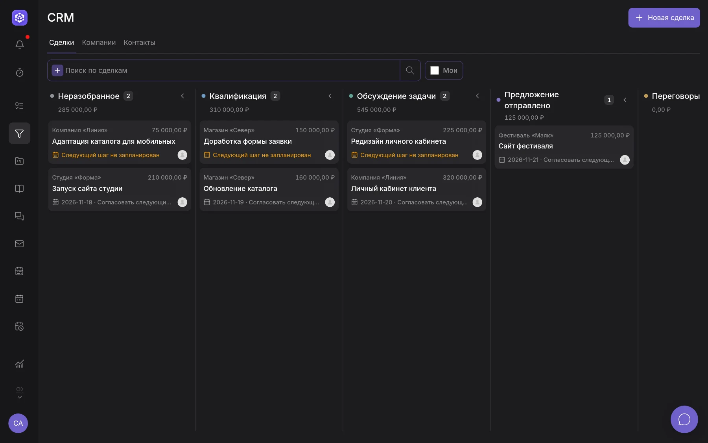

Ведите сделки по этапам и храните компании и контакты в CRM. Привязывайте задачи к сделкам, а для выигранной сделки создайте проект или выберите существующий.

### Проекты и бюджеты

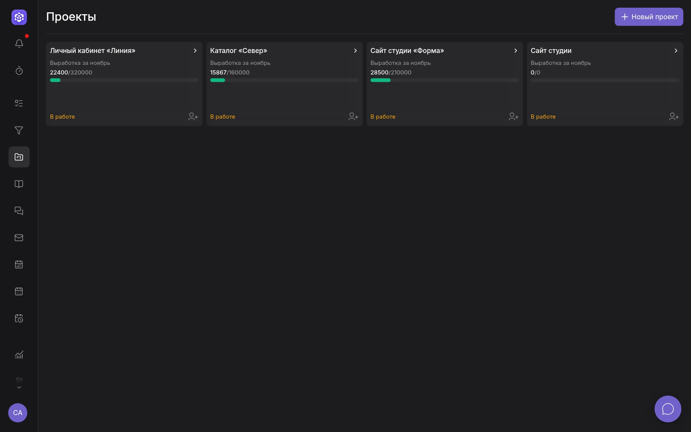

Задавайте месячный бюджет и почасовую ставку для проекта. Сравнивайте бюджет с выработкой команды по учтённому времени.

## Общение и документы

### Чаты

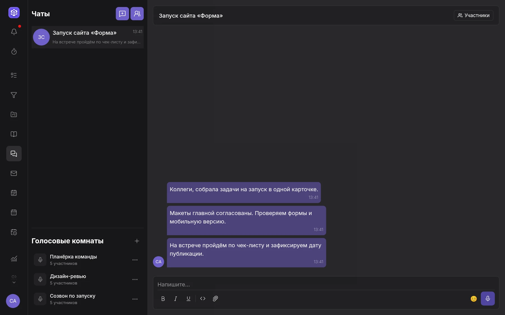

Обсуждайте проекты в личных и групповых чатах, отправляйте файлы и голосовые сообщения. О новых сообщениях и упоминаниях приходят push-уведомления.

### Голосовые комнаты

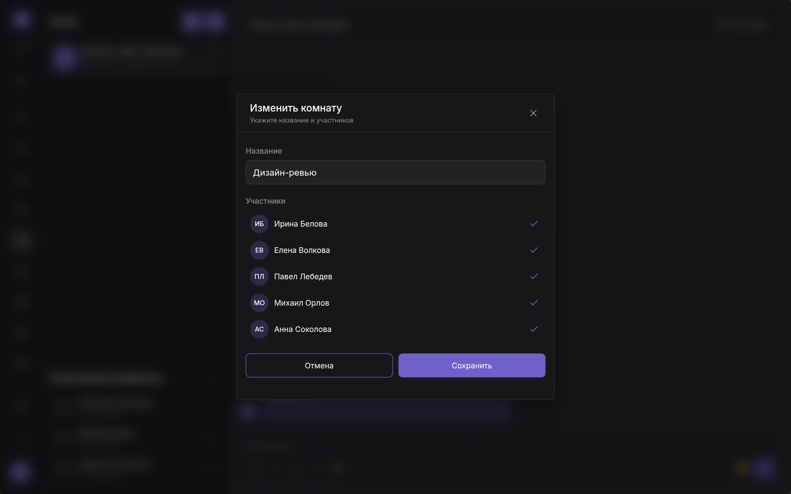

Создавайте комнаты для рабочих групп, выбирайте участников, созванивайтесь и показывайте экран.

### Встроенная почта

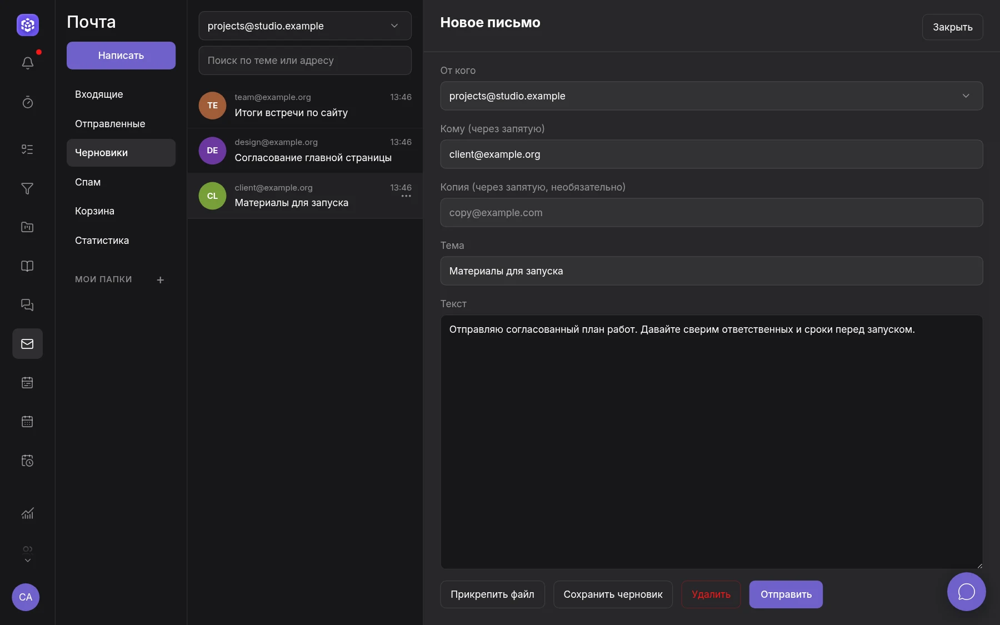

Ведите переписку с клиентами внутри трекера. В почте есть папки, цепочки писем и вложения.

### Календарь

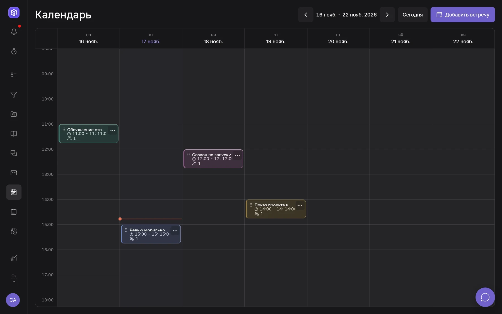

Назначайте встречи и приглашайте участников. В календаре видны события команды на неделе.

### База знаний

Храните регламенты, документацию проектов и материалы для новых сотрудников в дереве страниц. В редакторе есть таблицы и чек-листы, файлы можно хранить в S3.

## Учёт времени и отчёты

### Учёт времени

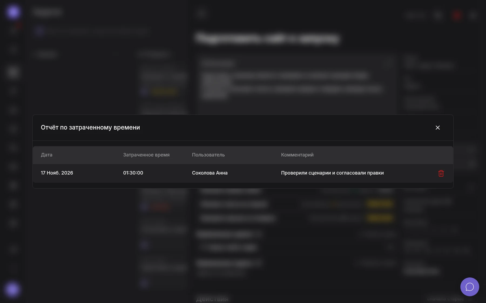

Запускайте таймер прямо из задачи или вносите часы вручную. Записи о времени попадают в отчёты и в фактическую загрузку команды.

### Отчёты

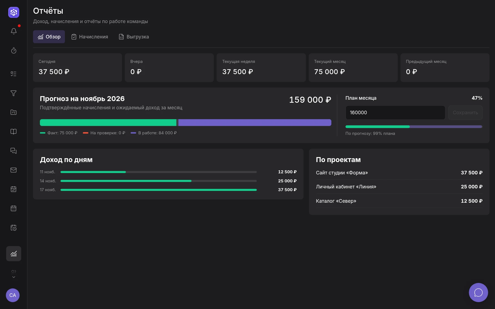

Смотрите, сколько времени ушло на каждый проект и кто выполнял задачи. Для клиента выгружайте в Excel сводку или детализацию с описаниями задач.

### Планирование загрузки

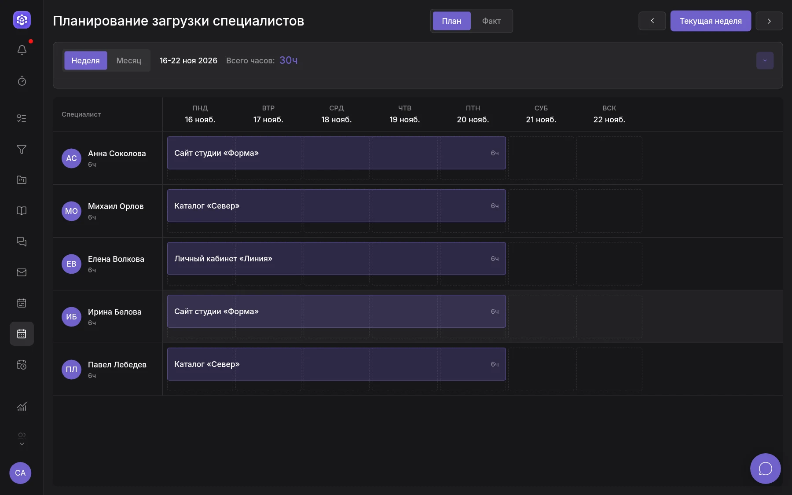

Распределяйте часы по людям и проектам на неделю. Переключайтесь между планом и фактом, чтобы видеть, где команда уже занята.

### График работы

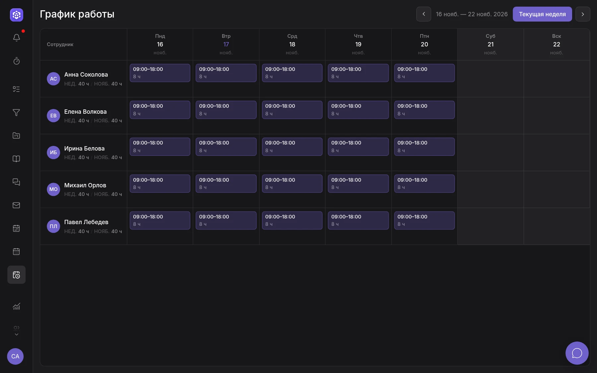

Настраивайте рабочие интервалы сотрудников. График помогает увидеть, кто доступен в конкретный день и время.

## Инструменты и доступ

### Git-репозитории

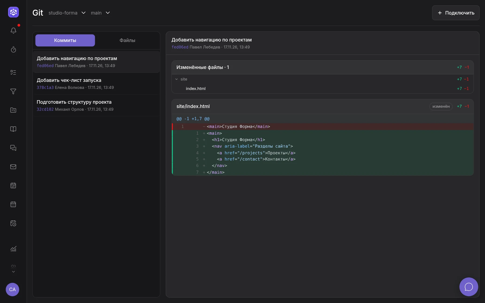

Привязывайте репозитории к проектам. Смотрите дерево файлов, историю коммитов и изменения кода прямо в Нервионе.

### Мониторинг сайтов

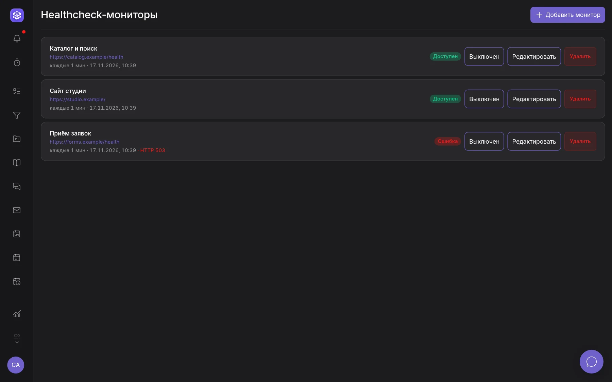

Следите за доступностью клиентских сайтов и сервисов. Задавайте интервал, таймаут и ожидаемый HTTP-статус, отправляйте уведомления о сбоях в чат.

### Роли и пользователи

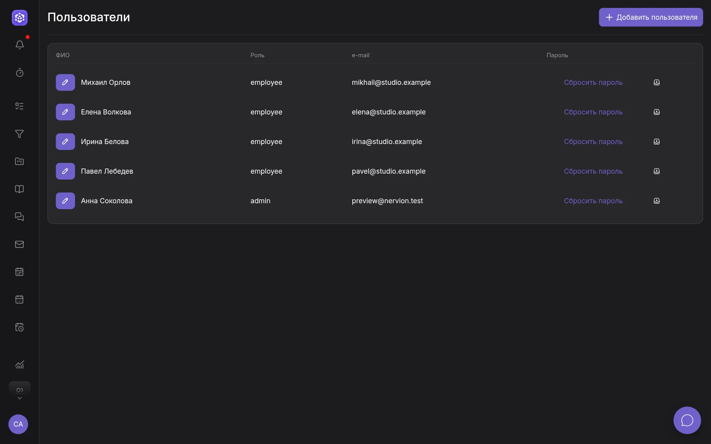

Назначайте роли и управляйте доступом к проектам. Архивируйте учётные записи с сохранением истории задач и записей времени.

### Журнал действий

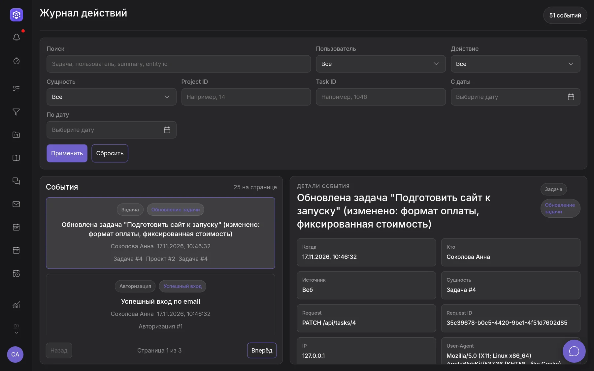

Смотрите, кто и когда менял задачи, проекты и пользователей. Детали события показывают состояние до и после изменения. Для анонсов команде есть раздел "Что нового".

## Запуск на своём сервере

Используйте [инструкцию по установке через Docker Compose](./docs/self-hosted.md). Она описывает настройку администратора, запуск PostgreSQL, API и веб-приложения.

Для разработки есть [инструкция по локальному запуску](./docs/development.md). Интерфейс написан на Nuxt 3 и Vue, API на NestJS с PostgreSQL. После запуска документация API доступна по адресу `http://localhost:3026/api/docs`. Для интеграций есть [описание CRM API](./docs/crm-api.md).

## Лицензия и вклад

Код доступен под [AGPLv3](./LICENSE). Условия коммерческого использования описаны в [LICENSING.md](./LICENSING.md).

Предложения и ошибки можно оставлять в [Issues](https://github.com/ar-webcetera/nervion/issues). Перед первым pull request ознакомьтесь с [правилами проекта](./AGENTS.md) и [соглашением для контрибьюторов](./CLA.md).
