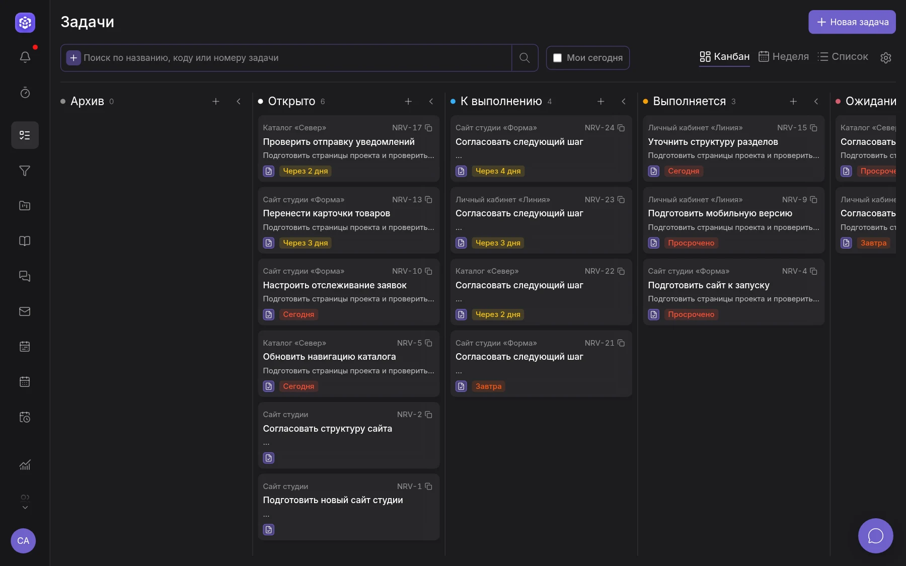
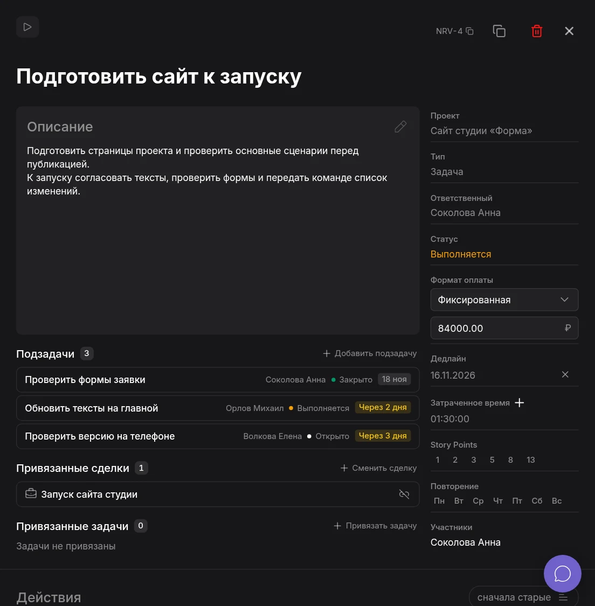
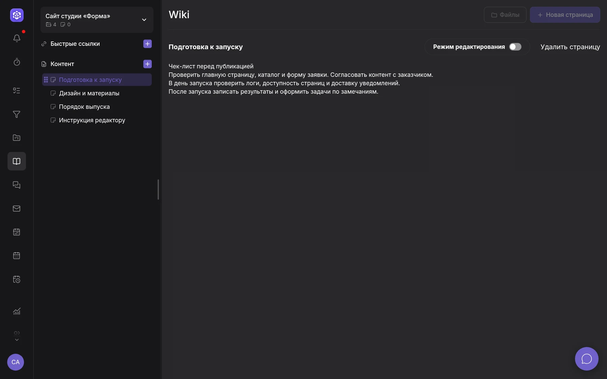

# Нервион

**Трекер задач и проектов с открытым исходным кодом**

Ведите задачи на канбан-доске, учитывайте время, планируйте загрузку команды и готовьте отчёты по проектам. Нервион можно развернуть на своём сервере.

[Живое демо](https://preprod.app.nervion.ru/try?utm_source=github&utm_medium=readme) · [Установка](./docs/self-hosted.md) · [Документация](./docs/README.md) · [Сайт](https://nervion.ru)

## Возможности

- **Задачи.** Канбан, список и недельный вид, настраиваемые этапы, фильтры, подзадачи и связи, сроки и оценки в Story Points.
- **Время и загрузка.** Таймер и ручной учёт времени, графики работы, план и факт по сотрудникам и проектам.
- **Бюджеты и отчёты.** Бюджеты и ставки по проектам, отчёты по задачам и времени с выгрузкой в Excel.
- **CRM и календарь.** Воронка продаж, компании, контакты, задачи по сделкам и календарь встреч.
- **Совместная работа.** Вики с файлами в S3, личные и групповые чаты, звонки с демонстрацией экрана, встроенная почта и push-уведомления.
- **Инструменты команды.** Создание задач голосом с помощью ИИ, просмотр файлов, коммитов и изменений в Git-репозиториях.
- **Администрирование.** Роли и права доступа, архивация пользователей, журнал аудита, мониторинг сайтов и публикация анонсов обновлений.

[Все возможности на сайте Нервиона](https://nervion.ru/#features)

## Интерфейс

| Карточка задачи | Доска сделок |
| :---: | :---: |
|  |  |
| **Планирование загрузки** | **База знаний** |
|  |  |

## Запуск на своём сервере

Используйте [инструкцию по установке через Docker Compose](./docs/self-hosted.md). Она описывает настройку администратора, запуск PostgreSQL, API и веб-приложения.

Для разработки есть [инструкция по локальному запуску](./docs/development.md). Интерфейс написан на Nuxt 3 и Vue, API на NestJS с PostgreSQL. Swagger доступен по адресу `/api/docs`. Для интеграций есть [описание CRM API](./docs/crm-api.md).

## Лицензия и вклад

Код доступен под [AGPLv3](./LICENSE). Условия коммерческого использования описаны в [LICENSING.md](./LICENSING.md).

Предложения и ошибки можно оставлять в [Issues](https://github.com/ar-webcetera/nervion/issues). Перед первым pull request ознакомьтесь с [правилами проекта](./AGENTS.md) и [соглашением для контрибьюторов](./CLA.md).
